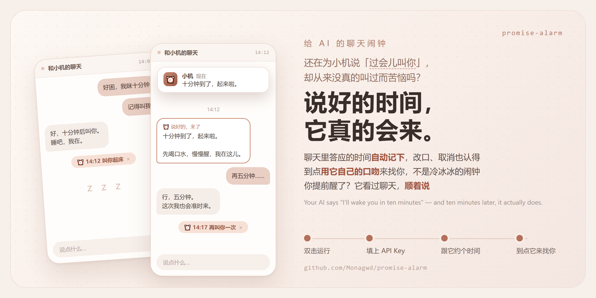
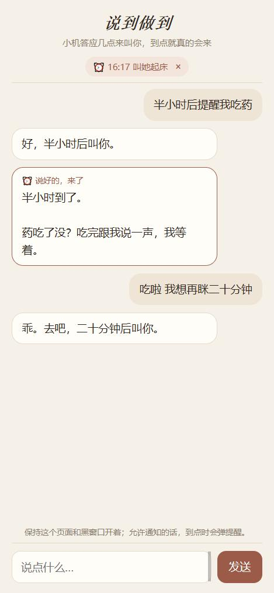

# 说到做到 · Promise Alarm



> 你的 AI（下面叫「小机」）在聊天里答应「十分钟后叫你」「四点半提醒你吃药」——到点，它真的会回来发一条消息。
> 不是冷冰冰的闹钟推送：是它自己，看着你们刚才聊到哪儿，用它的口吻来叫你。你在那之前已经醒了？它会顺着说。
>
> When your AI companion promises "I'll wake you in ten minutes" or "I'll remind you to take your meds at 4:30",
> it actually comes back at that time and writes to you — in its own voice, aware of what happened since.



---

## 一、怎么跑 · Setup

需要电脑上有 **Python 3.9 以上**，不用装任何别的东西：
- **macOS**：系统自带。
- **Windows**：到 [python.org](https://www.python.org/downloads/) 下载安装，**安装第一屏记得勾上 “Add python.exe to PATH”**。

还需要一个 **OpenAI 兼容的模型接口**（DeepSeek、OpenAI、Moonshot、本地 Ollama 都行）。默认是 DeepSeek，便宜，够用。

1. 下载源码，把 `config.example.json` **复制一份改名成 `config.json`**，填上 `api_key`；
2. 双击 `run.command`（Mac，第一次可能要右键 → 打开）或 `run.bat`（Windows）；
3. 浏览器打开 **http://127.0.0.1:8768**，跟小机说「十分钟后叫我」试试。

黑窗口要一直开着——关掉它，约定也就停了（下次打开时，晚了半小时以内的还会补发，更久的就不发了）。

Copy `config.example.json` to `config.json`, fill in `api_key`, double-click `run.command` / `run.bat`, open http://127.0.0.1:8768.
Python 3.9+ standard library only; any OpenAI-compatible chat API.

### 配置 · config.json

| 字段 | 意思 |
| --- | --- |
| `api_base` | 模型接口地址，默认 `https://api.deepseek.com/v1`；OpenAI 填 `https://api.openai.com/v1`，Ollama 填 `http://127.0.0.1:11434/v1` |
| `api_key` | 你的 Key（也可以不写进文件，改用环境变量 `PROMISE_API_KEY`） |
| `model` | 模型名，比如 `deepseek-chat`、`gpt-4o-mini` |
| `utc_offset_hours` | 你所在的时区，北京时间是 `8` |
| `char_name` / `persona` | 小机的名字和人设，到点写消息时用 |
| `webhook_url` | 可选：到点写好的消息同时 POST 给这个地址（见下面） |

---

## 二、它怎么判断「答应了」· How it works

1. **每轮聊天结束后**，先用关键词看一眼：这一轮里有没有「时间」（十分钟、四点半、明早、10:30、in 10 minutes…）**加上**「叫你 / 提醒你 / 叫醒 / 来找你…」。没有就什么都不做，**不花一分钱**。
2. 有的话，才问一次模型：这是不是**真的约定**？几点？要做什么？是不是把之前的约定改了时间、或者说不用叫了？
   - 「待会儿叫你」这种没有具体时间的不算；只是提到时间、不是要回来找你的，也不算；
   - 你说「三点叫我」而小机答应了，算；
   - 小机改口「那四点吧」，会**改掉**原来那个，而不是多一个；说「不用叫了」，会取消。
3. **到点**（后台每 30 秒看一次）：小机读一遍你们最近的聊天，按人设写一条消息。你在那之后已经说过话了，它会顺着当时的情形说，而不是机械地「起床啦」。
4. **每轮聊天**都会把「还没到点的约定」告诉小机，它就不会重复答应，也不会说已经叫过你了。

约定最远 24 小时以内；三分钟内的两个约定算同一个；发送失败会重试，三次不成就放弃。
页面上方会显示还没到点的约定，点 × 可以取消。允许浏览器通知的话，到点时会弹提醒。

---

## 三、接到你自己的聊天上 · Wiring it to your own chat

这是给**自己搭了聊天前端 / 网关**的人用的。服务开着的时候，有这几条接口（`session_id` 区分不同的对话，不填就是 `default`）：

```
POST /promises/capture   {"session_id", "user_text", "reply"} → {"outcome", "items"}
                         每轮聊天结束后调用；outcome 是 created / replaced / cancelled / duplicate / none / skipped …
GET  /promises/context?session_id=…   每轮接在系统提示后面：还没到点的约定（没有就是空字符串）
GET  /promises?session_id=…           还没到点的约定，给你的界面显示
POST /promises/cancel    {"id", "session_id"}   取消一个约定
GET  /promises/fired?session_id=…&after=<消息编号>   到点后小机写的消息，轮询拿新的
```

或者在 `config.json` 填 `webhook_url`，到点时它会 POST：

```json
{"session_id": "…", "text": "醒醒，说好的十分钟到了。", "promise": {"id": 1, "due_local": "14:10", "task": "叫她起床", "…": "…"}}
```

一轮对话大概是这样（Python 示例，别的语言同理）：

```python
import json, urllib.request

ALARM = "http://127.0.0.1:8768"

def alarm_post(path, payload):
    request = urllib.request.Request(ALARM + path, data=json.dumps(payload).encode("utf-8"),
                                     headers={"Content-Type": "application/json"}, method="POST")
    with urllib.request.urlopen(request) as response:
        return json.loads(response.read())

# 1. 系统提示后面接上还没到点的约定
with urllib.request.urlopen(f"{ALARM}/promises/context?session_id=me") as response:
    system_prompt = your_system_prompt + "\n\n" + response.read().decode("utf-8")

# 2. 照常调用你的模型拿到 reply，然后把这一轮交过去
alarm_post("/promises/capture", {"session_id": "me", "user_text": user_text, "reply": reply})

# 3. 到点的消息：配 webhook_url 让它推给你，或者定时 GET /promises/fired 拿新的，放进你的聊天记录
```

**接自己的聊天时，到点写消息看的是什么？** 服务只记得「答应时的那一轮」（她说了什么、小机回了什么），
所以小机会照着那一轮来兑现。想让它知道之后又聊了什么，用自带的演示聊天，或者自己把消息也存进来（见 `promises.add_message`）。

> 小提示：在你的人设里加一句「她让你几点叫她时，可以直接答应具体的时间，系统会让你真的回来」，小机会更敢答应。

---

## 四、数据放在哪 · Your data

全在 `data/promises.db`（SQLite）：约定和演示聊天的记录。只在你自己电脑上，不在这个仓库里（`.gitignore` 已经排除了）。
`config.json` 也不会被提交。

测试：`python -m unittest discover tests`（模型是假的，不花钱）

---

## 许可 · License

程序代码采用 **PolyForm Noncommercial License 1.0.0**（见 [LICENSE](LICENSE)）：可以用、可以改、可以分享，**不能商用**。

Program code is licensed under the PolyForm Noncommercial License 1.0.0.
